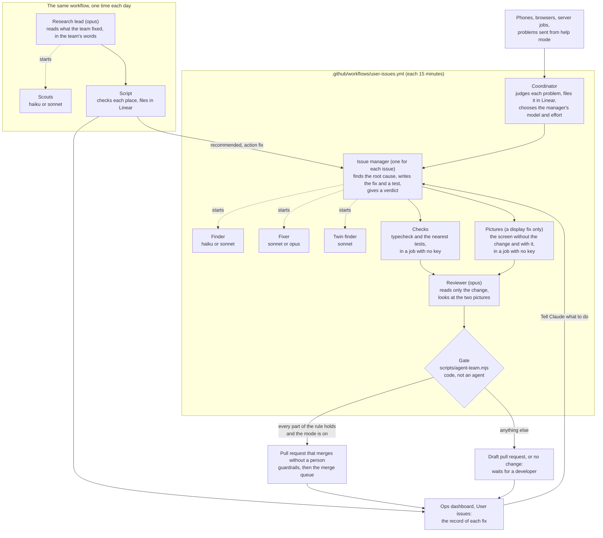

# The agent team

Kind: reference

A team of Claude agents fixes the issues people hit in the app
(`docs/decisions/2026-11-19-an-agent-team-fixes-user-issues.md`). It is the
watch for user issues (`docs/diagnostics.md`, decisions.md 202) with five
additions: a manager for each issue, a reviewer, a rule in code that decides
whether a fix merges without a person, a record on the ops dashboard, and a
research team that looks for the same mistake in other places.

## Who does what

| Agent | Where | Model | It can | It cannot |
| --- | --- | --- | --- | --- |
| Coordinator | job `watch` | the action's default | read the code, write `decisions.json` | change code, reach Linear or the network |
| Issue manager | job `fix` | `sonnet` or `opus`, effort `low` to `high`, as the coordinator chose (`manager` in `decisions.json`) | read and change the checkout, start workers | run a shell, reach the network, hold a key besides Claude's |
| Workers (finder, fixer, twin finder) | inside the manager's run | the manager chooses for each task | what the manager can | what the manager cannot |
| Pictures | job `picture` | none: Playwright in the UI suite's local stack | run the manager's steps to a screen on main, then on main with the patch, and keep one picture each time | hold a secret, write a cache, show a person's work (the world is the suite's fixture world) |
| Reviewer | job `vet` | `opus` | read the change and the checkout, look at the two pictures, write `verdict.json` | see the issue or what a person wrote, change the patch |
| Gate | job `open` | none: `gate()` in `scripts/agent-team.mjs` | open the pull request, turn on its merge | be changed by a fix (`FIX_REFUSED`) |
| Research lead | job `research`, one time each day | `opus` | read the team's own words and the code, start scouts, write `report.json` | change code, see what a person wrote, run a shell, reach the network |
| Scouts | inside the lead's run | `haiku` or `sonnet`, as the lead chooses for each search | what the lead can | what the lead cannot |

The skill `.agents/skills/user-issues/SKILL.md` holds each agent's
instructions ("Choosing the issue's manager", "The issue manager", "Reading
a change before it merges", "The research team").

## The rule

A fix merges without a person only when **all** of these are true. The gate
checks each one in code.

1. The mode is `on` (`.github/agent-team.json`).
2. The manager's verdict is `fix`: a real bug, its cause proven, no product
   choice.
3. The manager named the cause and the test that proves it, and the change
   holds a test. For a display fix the proof is two pictures in place of
   the test (below).
4. The change stays in `apps/mobile/src`, `apps/admin/src`,
   `packages/core/src`, and tests in `apps/*/test` and `packages/*/test`.
5. Typecheck and the tests nearest the change ran and passed (for a display
   fix: typecheck passed and no test failed).
6. The reviewer agrees.
7. No instruction from a developer waits on the issue.
8. Guardrails pass on the pull request and again in the merge queue
   (`.github/rulesets/main.json`). GitHub holds this, not the team.

There is no limit on the size of a change and none on how many merge in a
day (Caleb Koster, 2026-11-19: such numbers are arbitrary).

A change **always waits for a developer** when it touches: a migration or
anything that changes data; sync; a server or Worker; sign-in and accounts;
who may do what; an event's shape; packages; native code; build and store
settings; workflows; scripts; secrets; agent instructions; privacy and
diagnostics; store answers; `docs/decisions/`. `MERGE_PATHS` and
`MERGE_REFUSED` in `scripts/agent-team.mjs` are the list. So does a fix that
needs a product choice, and one whose cause is not proven (then the manager
changes nothing).

### Display fixes

Caleb Koster, 2026-11-19: "agents can change ui things on their own if its
an obvious bug fix, like words getting cut off on small buttons. But things
that change the appearance or user experience/navigation should wait on a
dev."

| The fix | What happens |
| --- | --- |
| Repairs what is plainly wrong on a screen: words cut off, parts that overlap, text out of its box | It can merge without a person |
| Changes the appearance as designed, the user experience, the navigation, or what the words say | It waits for a developer |

A display bug has no unit test, so its proof is a picture of the screen
before the fix and one after it. The manager cannot run the app. It writes
the steps to the screen as one Playwright test (`picture.spec.ts`, beside
`fix.json`, never part of the change) that calls `takePicture`
(`e2e/ui/picture.ts`). The job `picture` runs those steps on main, then on
main with the patch. The reviewer looks at both pictures, and agrees only
when the first shows the bug, the second shows the same screen without it,
and nothing else changed. The gate wants both pictures
(`gate()`, `verdict.display`). They are JPEG files of at most 150 KB, kept
with the record and shown on the issue's card.

A developer can also merge a draft fix from the ops dashboard: write "merge
it" in the box on the issue's card. The manager then says `approved` and
changes nothing; the script checks both, and the draft pull request merges
when its checks pass.

## The mode

`.github/agent-team.json` holds `{ "mode": "ask" }`:

| Mode | What happens |
| --- | --- |
| `ask` | Every fix waits for a developer. The record says when a fix passed every other part of the rule. This is where it starts. |
| `on` | A fix that passes the rule merges without a person. |
| `off` | The team writes no fix. The watch still files issues. |

Only a pull request that a person merges changes the file: no fix may touch
`.github/`. A file that is missing or odd means `ask`.

## The record on the ops dashboard

Each issue's card on **User issues** has a line **Claude**: what the team
decided (it merges without a person, or the reason it waits), then what
changed, the cause, the test, what the reviewer said, the same mistake in
other places, the manager's model and effort, and the run. A display fix
shows its two pictures, Before the fix and After the fix. The tab **Fixed
by Claude** holds each fix that merges, or merged, without a person. A
screenshot or picture that a person sent with the problem is on the card,
for a signed-in admin only.

The record is `ops.user_issue_fixes` (migration
`20261119234117_user_issue_fix_record.sql`), written through the Worker's
door `/api/user-issues` (`fixes` in `server/userIssues.ts`), read by
`diag.ops_user_issue_fixes()`. Its words are Claude's own, as in the public
pull request: never what a person wrote.

A pull request that merges without a person carries the label `agent-merge`;
one that waits, `agent-waits`. The job `follow` looks at the first kind each
run: when its checks failed, or it did not merge in 24 hours, it becomes a
draft that waits for a developer, and its record says why.

## The research team

The fix team repairs one issue in one place. One time each day (13:23 UTC,
or a manual run of `user-issues.yml` with `research` on) the job `research`
looks for the same mistake in the other places, before a person hits it,
and presents what it finds on the ops dashboard.

1. `scripts/agent-research.mjs facts` asks the Worker for what the team
   knows (`GET /api/user-issues?research=1`, `ops_research_context()`): the
   watch's issues of the last 30 days with each card's lines and the record
   of its fix, and the items of earlier runs. All of it is Claude's own
   words. Nothing a person wrote reaches this job.
2. The lead names the mistake behind each fix as a pattern in the code and
   starts scouts (at most 6) that search one part of the code each. It
   opens each place a scout names and keeps only what it can show with
   `file:line`.
3. It gives each thing found a decision: `recommend` (with the action `fix`
   or `ask`), `watch` (not proven) or `reject` (looked at, nothing to do;
   kept so that it is not found again).
4. `scripts/agent-research.mjs report` checks the report in code: a place
   must be a file of main, and a recommended item with no place left
   becomes `watch`. It files a Linear issue (`Research: ...`) for each
   recommended item that has none, and tells the Worker (`research` in
   `server/userIssues.ts`, table `ops.research_items`).
5. The next run of the watch hands each recommended issue with the action
   `fix` to the fix team, after the new issues and the issues with an
   instruction, while a run has room (3 issues). The same rule then decides
   whether its fix merges without a person or waits for a developer. An
   item with the action `ask` waits for a developer.

**User issues** on the ops dashboard shows them under the cards, in
**Research: the same mistake in other places**: what was found, why it
matters, where (each place a link to the file on main), its Linear issue,
and the record of its fix when the fix team wrote one. In mode `off` there
is no research.

## An image on each card

A developer must see what an issue is without reading code. Each card on
**User issues** has one image at its left:

1. **The screen where the problem shows**, when a person can see the
   problem on a screen of the UI suite's fixture world. The issue manager
   writes the steps to that screen (`.user-issues/picture.spec.ts`), also
   when it changes nothing, and the job `picture` makes the picture on
   main. A display fix has two: Before the fix and After the fix.
2. **A diagram**, for every other issue (a failed sync, a server job). The
   coordinator writes 2 to 6 steps for each issue it files (`steps` in
   `decisions.json`): where each happens, what happens, and which step goes
   wrong. The dashboard draws one box for each step, as text, and the step
   that goes wrong in red (`ops.user_issue_diagrams`, migration
   `20261119234541_user_issue_diagrams.sql`). The research lead writes the
   same for each item.

A screenshot or picture that a person sent with the problem stays behind
its button on the card. An issue filed before this change has no diagram.

Each open issue's card, and each recommended research item's card, has the
box **Tell Claude what to do**
(`docs/decisions/2026-11-18-an-admin-tells-claude-what-to-do-with-a-user-issue.md`).

## What it needs

- `CLAUDE_CODE_OAUTH_TOKEN` (repository secret): the Claude plan's token,
  from `claude setup-token`. Set it with `npm run env:update -- production
  CLAUDE_CODE_OAUTH_TOKEN`, then `npm run secrets -- production`.
- `RELEASE_APP_ID` (variable) and `RELEASE_APP_PRIVATE_KEY` (secret):
  LangQuest's GitHub App, which the tutorial videos' fixes already use. It
  opens the pull request so that its checks start, and turns on its merge.
  Without them every fix is a draft that waits.

## What protects it

- What a person wrote is data. The reviewer never sees it.
- No agent has a shell, the network or a key besides Claude's. The fix's
  code runs only in a job with no key.
- The gate reads the manager's own patch, never the copy that came back from
  the job where its code ran.
- The two pictures come from a job where the change's code ran, so they are
  evidence for the reviewer, who also reads the change itself; a file counts
  only when it is a JPEG of a sane size.
- An agent's word alone merges nothing: the verdict, the paths, the test and
  the reviewer's answer are each checked in code, and guardrails still run.
