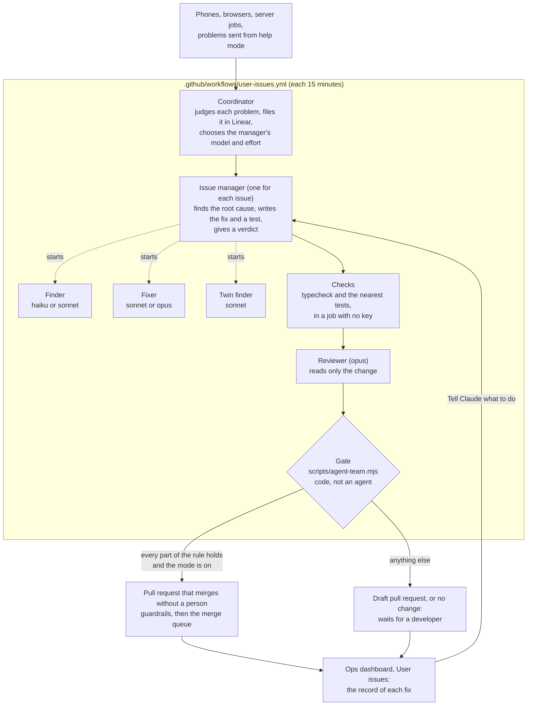

# The agent team

A team of Claude agents fixes the issues people hit in the app
(`docs/decisions/2026-11-19-an-agent-team-fixes-user-issues.md`). It is the
watch for user issues (`docs/diagnostics.md`, decisions.md 202) with four
additions: a manager for each issue, a reviewer, a rule in code that decides
whether a fix merges without a person, and a record on the ops dashboard.

## Who does what

| Agent | Where | Model | It can | It cannot |
| --- | --- | --- | --- | --- |
| Coordinator | job `watch` | the action's default | read the code, write `decisions.json` | change code, reach Linear or the network |
| Issue manager | job `fix` | `sonnet` or `opus`, effort `low` to `high`, as the coordinator chose (`manager` in `decisions.json`) | read and change the checkout, start workers | run a shell, reach the network, hold a key besides Claude's |
| Workers (finder, fixer, twin finder) | inside the manager's run | the manager chooses for each task | what the manager can | what the manager cannot |
| Reviewer | job `vet` | `opus` | read the change and the checkout, write `verdict.json` | see the issue or what a person wrote, change the patch |
| Gate | job `open` | none: `gate()` in `scripts/agent-team.mjs` | open the pull request, turn on its merge | be changed by a fix (`FIX_REFUSED`) |

The skill `.agents/skills/user-issues/SKILL.md` holds each agent's
instructions ("Choosing the issue's manager", "The issue manager", "Reading
a change before it merges").

## The rule

A fix merges without a person only when **all** of these are true. The gate
checks each one in code.

1. The mode is `on` (`.github/agent-team.json`).
2. The manager's verdict is `fix`: a real bug, its cause proven, no product
   choice.
3. The manager named the cause and the test that proves it, and the change
   holds a test.
4. The change stays in `apps/mobile/src`, `apps/admin/src`,
   `packages/core/src`, and tests in `apps/*/test` and `packages/*/test`.
5. Typecheck and the tests nearest the change ran and passed.
6. The reviewer agrees.
7. No instruction from a developer waits on the issue.
8. Guardrails pass on the pull request and again in the merge queue
   (`.github/rulesets/main.json`). GitHub holds this, not the team.

There is no limit on the size of a change and none on how many merge in a
day (Caleb Koster, 2026-11-19: such numbers are arbitrary).

A change **always waits for a developer** when it touches: a migration or
anything that changes data; sync; a server or Worker; sign-in and accounts;
who may do what; an event's shape; packages; native code; build and store
settings; workflows; scripts; secrets; agent instructions; privacy and
diagnostics; store answers; `docs/decisions/`. `MERGE_PATHS` and
`MERGE_REFUSED` in `scripts/agent-team.mjs` are the list. So does a fix that
needs a product choice, and one whose cause is not proven (then the manager
changes nothing).

A developer can also merge a draft fix from the ops dashboard: write "merge
it" in the box on the issue's card. The manager then says `approved` and
changes nothing; the script checks both, and the draft pull request merges
when its checks pass.

## The mode

`.github/agent-team.json` holds `{ "mode": "ask" }`:

| Mode | What happens |
| --- | --- |
| `ask` | Every fix waits for a developer. The record says when a fix passed every other part of the rule. This is where it starts. |
| `on` | A fix that passes the rule merges without a person. |
| `off` | The team writes no fix. The watch still files issues. |

Only a pull request that a person merges changes the file: no fix may touch
`.github/`. A file that is missing or odd means `ask`.

## The record on the ops dashboard

Each issue's card on **User issues** has a line **Claude**: what the team
decided (it merges without a person, or the reason it waits), then what
changed, the cause, the test, what the reviewer said, the same mistake in
other places, the manager's model and effort, and the run. The tab **Fixed
by Claude** holds each fix that merges, or merged, without a person. A
screenshot or picture that a person sent with the problem is on the card,
for a signed-in admin only.

The record is `ops.user_issue_fixes` (migration
`20261119211347_user_issue_fix_record.sql`), written through the Worker's
door `/api/user-issues` (`fixes` in `server/userIssues.ts`), read by
`diag.ops_user_issue_fixes()`. Its words are Claude's own, as in the public
pull request: never what a person wrote.

A pull request that merges without a person carries the label `agent-merge`;
one that waits, `agent-waits`. The job `follow` looks at the first kind each
run: when its checks failed, or it did not merge in 24 hours, it becomes a
draft that waits for a developer, and its record says why.

## What it needs

- `CLAUDE_CODE_OAUTH_TOKEN` (repository secret): the Claude plan's token,
  from `claude setup-token`. Set it with `npm run env:update -- production
  CLAUDE_CODE_OAUTH_TOKEN`, then `npm run secrets -- production`.
- `RELEASE_APP_ID` (variable) and `RELEASE_APP_PRIVATE_KEY` (secret):
  LangQuest's GitHub App, which the tutorial videos' fixes already use. It
  opens the pull request so that its checks start, and turns on its merge.
  Without them every fix is a draft that waits.

## What protects it

- What a person wrote is data. The reviewer never sees it.
- No agent has a shell, the network or a key besides Claude's. The fix's
  code runs only in a job with no key.
- The gate reads the manager's own patch, never the copy that came back from
  the job where its code ran.
- An agent's word alone merges nothing: the verdict, the paths, the test and
  the reviewer's answer are each checked in code, and guardrails still run.
