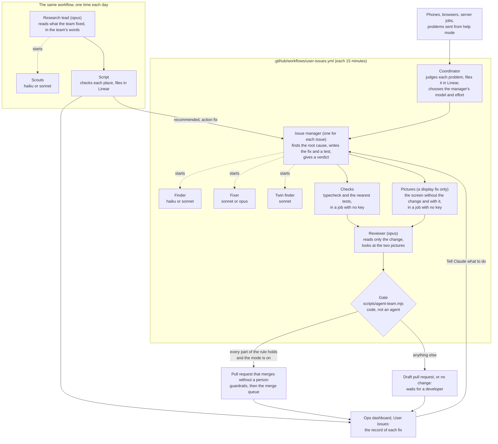
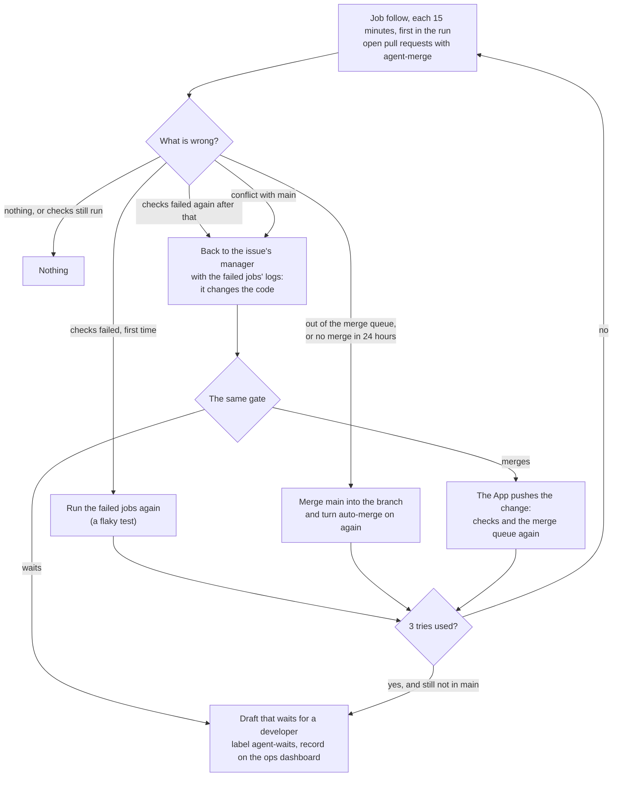
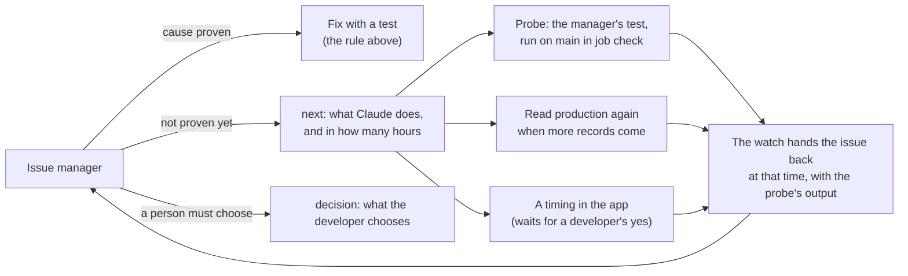

# The agent team

Kind: reference

A team of Claude agents fixes the issues people hit in the app
(`docs/decisions/2026-11-19-an-agent-team-fixes-user-issues.md`). It is the
watch for user issues (`docs/diagnostics.md`, decisions.md 202) with five
additions: a manager for each issue, a reviewer, a rule in code that decides
whether a fix merges without a person, a record on the ops dashboard, and a
research team that looks for the same mistake in other places.

## Who does what

| Agent | Where | Model | It can | It cannot |
| --- | --- | --- | --- | --- |
| Coordinator | job `watch` | the action's default | read the code, write `decisions.json` | change code, reach Linear or the network |
| Issue manager | job `fix` | `sonnet` or `opus`, effort `low` to `high`, as the coordinator chose (`manager` in `decisions.json`) | read and change the checkout, start workers, read production as `agent_reader` (`docs/production-reads.md`), write a probe test that the job `check` runs | run any other shell, reach any other network, hold a key besides Claude's |
| Probe | job `check` | none: vitest | run the manager's own test on main (with the change, when there is one) and keep its last 6000 characters for the manager's next try | hold a secret, write a cache |
| Workers (finder, fixer, twin finder) | inside the manager's run | the manager chooses for each task | what the manager can | what the manager cannot |
| Pictures | job `picture` | none: Playwright in the UI suite's local stack | run the manager's steps to a screen on main, then on main with the patch, and keep one picture each time | hold a secret, write a cache, show a person's work (the world is the suite's fixture world) |
| Reviewer | job `vet` | `opus` | read the change and the checkout, look at the two pictures, write `verdict.json` | see the issue or what a person wrote, change the patch |
| Gate | job `open` | none: `gate()` in `scripts/agent-team.mjs` | open the pull request, turn on its merge | be changed by a fix (`FIX_REFUSED`) |
| Research lead | job `research`, one time each day | `opus` | read the team's own words and the code, start scouts, write `report.json` | change code, see what a person wrote, run a shell, reach the network |
| Scouts | inside the lead's run | `haiku` or `sonnet`, as the lead chooses for each search | what the lead can | what the lead cannot |

The skill `.agents/skills/user-issues/SKILL.md` holds each agent's
instructions ("Choosing the issue's manager", "The issue manager", "Reading
a change before it merges", "The research team").

## The rule

A fix merges without a person only when **all** of these are true. The gate
checks each one in code.

1. The mode is `on` (`.github/agent-team.json`).
2. The manager's verdict is `fix`: a real bug, its cause proven, no product
   choice.
3. The manager named the cause and the test that proves it, and the change
   holds a test. For a display fix the proof is two pictures in place of
   the test (below).
4. The change stays in `apps/mobile/src`, `apps/admin/src`,
   `packages/core/src`, and tests in `apps/*/test` and `packages/*/test`.
5. Typecheck and the tests nearest the change ran and passed (for a display
   fix: typecheck passed and no test failed).
6. The reviewer agrees.
7. No instruction from a developer waits on the issue. (Fix it on a
   tutorial video's card is the exception: below.)
8. Guardrails pass on the pull request and again in the merge queue
   (`.github/rulesets/main.json`). GitHub holds this, not the team.

There is no limit on the size of a change and none on how many merge in a
day (Caleb Koster, 2026-11-19: such numbers are arbitrary).

A change **always waits for a developer** when it touches: a migration or
anything that changes data; sync; a server or Worker; sign-in and accounts;
who may do what; an event's shape; packages; native code; build and store
settings; workflows; scripts; secrets; agent instructions; privacy and
diagnostics; store answers; `docs/decisions/`. `MERGE_PATHS` and
`MERGE_REFUSED` in `scripts/agent-team.mjs` are the list. So does a fix that
needs a product choice, and one whose cause is not proven yet (then the
manager carries out a plan to prove it: below).

### Display fixes

Caleb Koster, 2026-11-19: "agents can change ui things on their own if its
an obvious bug fix, like words getting cut off on small buttons. But things
that change the appearance or user experience/navigation should wait on a
dev."

| The fix | What happens |
| --- | --- |
| Repairs what is plainly wrong on a screen: words cut off, parts that overlap, text out of its box | It can merge without a person |
| Changes the appearance as designed, the user experience, the navigation, or what the words say | It waits for a developer |

A display bug has no unit test, so its proof is a picture of the screen
before the fix and one after it. The manager cannot run the app. It writes
the steps to the screen as one Playwright test (`picture.spec.ts`, beside
`fix.json`, never part of the change) that calls `takePicture`
(`e2e/ui/picture.ts`). The job `picture` runs those steps on main, then on
main with the patch. The reviewer looks at both pictures, and agrees only
when the first shows the bug, the second shows the same screen without it,
and nothing else changed. The gate wants both pictures
(`gate()`, `verdict.display`). They are JPEG files of at most 150 KB, kept
with the record and shown on the issue's card.

### Fix it on a tutorial video's card

An admin can say Fix it on a tutorial video's suggestion whose fix is in the
app, and the video fix run hands one over itself when it finds that the cause
of a change a person accepted is in the app
(`docs/decisions/2026-11-21-fix-it-sends-a-video-suggestion-to-the-agent-team.md`).
Its instructions are kept with `go`. The admin's word is the yes for that one
fix: rules 1 and 7 do not hold it, and every other rule still does. So it
merges with no person, also in mode `ask`, only when it changes app screens
or words, the dashboard, the core and tests, its cause is proven and it does
only what was asked, a test or the two pictures prove it, and the checks and
the reviewer pass. It waits for the admin when they ticked "Ask me before it
merges", when an instruction on the card asks that in words (`saysAskFirst`),
or when the manager says `askFirst` in `fix.json`. A repair of such a fix
(below) keeps `go`. After the merge, the video fix run films the video again.

A developer can also merge a draft fix from the ops dashboard: write "merge
it" in the box on the issue's card. The manager then says `approved` and
changes nothing; the script checks both, and the draft pull request merges
when its checks pass.

## The mode

`.github/agent-team.json` holds `{ "mode": "ask" }`:

| Mode | What happens |
| --- | --- |
| `ask` | Every fix waits for a developer, except one an admin asked for with Fix it on a tutorial video's card (above). The record says when a fix passed every other part of the rule. This is where it starts. |
| `on` | A fix that passes the rule merges without a person. |
| `off` | The team writes no fix. The watch still files issues. |

Only a pull request that a person merges changes the file: no fix may touch
`.github/`. A file that is missing or odd means `ask`.

## The record on the ops dashboard

Each issue's card on **User issues** has a line **Claude**: what the team
decided (it merges without a person, or the reason it waits), then what
changed, the cause, the test, what the reviewer said, the same mistake in
other places, the manager's model and effort, and the run. A display fix
shows its two pictures, Before the fix and After the fix. The tab **Fixed
by Claude** holds each fix that merges, or merged, without a person. A
screenshot or picture that a person sent with the problem is on the card,
for a signed-in admin only.

The record is `ops.user_issue_fixes` (migration
`20261119234117_user_issue_fix_record.sql`), written through the Worker's
door `/api/user-issues` (`fixes` in `server/userIssues.ts`), read by
`diag.ops_user_issue_fixes()`. Its words are Claude's own, as in the public
pull request: never what a person wrote.

A pull request that merges without a person carries the label `agent-merge`;
one that waits, `agent-waits`.

## When a fix does not get into main

Trivial fixes often fail on the way into main: a flaky test, a removal
from the merge queue, a conflict with a newer main. A developer does not
hear about these. Claude tries to get the fix into main, up to 3 times;
only then does the pull request wait for a developer (Caleb Koster,
2026-11-20). This applies only to a pull request that merges without a
person, which the gate let through.

- Each action is one try. The pull request's body keeps the count in a
  hidden line (`<!-- agent-team: try 2 rerun ... -->`), which
  `triesOf()` in `scripts/agent-team.mjs` reads; `nextStep()` decides the
  action, in code.
- A change by the manager goes through check, pictures, reviewer and gate
  as a new fix does. The gate reads the whole fix against main, so the
  rule is the same. LangQuest's GitHub App pushes it, so its checks start.
- The manager reads the logs of the failed jobs. It never skips or weakens
  a test; when the failure is not the change's (it also fails on main, or
  the runner failed), it changes nothing and the pull request waits.
- In mode `off`, or without `AGENT_TEAM_CLAUDE_TOKEN`, a pull request that
  needs a change waits for a developer at once.
- At most 2 pull requests a run go back to the manager; they do not take
  the room of new issues (`FIX_MAX`).

## When the cause is not proven yet

Caleb Koster, 2026-11-21: a card that ends with "the cause was not proven"
asks a developer for the obvious answer, "then prove it". The manager must
prove the cause itself, or propose a plan that proves it and carry the plan
out (`docs/decisions/2026-11-21-the-issue-manager-proves-the-cause-or-carries-out-a-plan.md`).

1. The manager reads production first (read only, as `agent_reader`), and
   follows the code from where the numbers point.
2. When it has no proof, `fix.json` holds `next` (`nextOf` in
   `scripts/agent-team.mjs`): `do`, what Claude does next, in a sentence;
   `steps`, the whole plan; `inHours`, from 0.25 to 168; and `probeAt`, the
   test folder of a probe. A manager that wrote no `next` (or whose job
   failed) gets a default one: it tries again at the next run (`planNext`).
3. A probe (`.user-issues/probe.test.ts`) runs in the job `check`, which
   holds no key, on main with the change when there is one. Its last 6000
   characters go with the record (`ops.user_issue_plans.probe`), never to the
   dashboard or the pull request.
4. A timing the plan needs is a change to diagnostics, so it waits for a
   developer (`review`). The card says so, and what Claude does after the
   merge.
5. The watch reads `ops_user_issue_plans_due()` each run and hands each
   issue whose time came back to the fix jobs, in the order of "Which issue
   Claude takes first", while `FIX_MAX` has room. `issue.json` then holds `plan`: the last plan, its
   tries and what the probe printed.
6. The issue's card says what Claude does next and when, never only "not
   proven". A Linear comment says the same.
7. Each hand-back counts one try, and the issue waits at least 2 hours
   before the next, also when the run's job failed and wrote no plan. After
   `PLAN_TRIES` (10) tries the issue waits 24 hours between tries, and the
   watch never stops handing it back while it is open. A record with a fix,
   a decision or no plan removes the plan.
8. A manager whose run ended before it wrote `fix.json` gave no verdict.
   The card says so (never "did not prove the cause"), and the watch runs
   the manager again. The job log's step "How the manager's run ended"
   says how it ended, its turns, the tools it was refused and how many
   workers it left in the background, and nothing that Claude or people
   wrote. When `fix.json` is missing, the step "The manager writes its
   verdict" goes on in the same session once, to write it.
9. A card never ends at "a developer decides" alone. With no plan, it says
   what Claude found: "Claude found no bug" with the reason, "Claude needs
   your choice" with the choice, or the gate's reason with Claude's words.

## Which issue Claude takes first

Each run hands at most `FIX_MAX` (3) issues to the fix jobs. First go the
team's pull requests that did not get into main (room of their own), then
the issues with an admin's instruction. Then one order holds every other
issue that waits for the fix team: the new issues, the plans whose time
came, the research's and the issues Claude never tried
(`ops_user_issue_order()`, `orderToTake()` in `scripts/user-issues.mjs`).
The order is Linear's priority (Urgent, High, Medium or none, Low), then
the most people of one of its kinds in 7 days, then how many kinds point to
it, then how many places the research found with the same mistake, then
times, then the oldest. Each run reads each open issue's priority with its
state (`ops.user_issue_priorities`), so a developer who changes a priority
in Linear changes the order at the next run. The run that files new issues
reads the order again after it files them, so a new urgent issue goes
first at once. The job log says each issue's place and why. The Overview's
"On its way" shows the next run's issues in this order with the same why
(`diag.ops_user_issue_order()`).
(`docs/decisions/2026-11-22-the-fix-team-takes-the-most-important-issue-first.md`)

## Issues Claude never tried

Each run hands at most `FIX_MAX` (3) issues to the fix jobs, one after the
other, in the order above. The open issues Claude never tried are in it:
no fix record, and no run handed them over (`ops_user_issue_untried()` has
the same rule). Each run tells the Worker
every issue it handed over (`tried`, kept in `ops.user_issue_tries`), so an
issue is not tried twice this way, and the ops dashboard knows when Claude
started on it. An issue a developer has In Progress or In Review in Linear
is left alone. An issue whose try gave no record comes back only on an
admin's instruction from its card
(`docs/decisions/2026-11-21-on-its-way-says-what-happens-next.md`).

The Overview's "On its way" shows the next run's issues and how many wait
after them; an issue where Claude stopped, or whose draft fix waits to be
read, is under "This week, you decide".

## The research team

The fix team repairs one issue in one place. One time each day (13:23 UTC,
or a manual run of `user-issues.yml` with `research` on) the job `research`
looks for the same mistake in the other places, before a person hits it,
and presents what it finds on the ops dashboard.

1. `scripts/agent-research.mjs facts` asks the Worker for what the team
   knows (`GET /api/user-issues?research=1`, `ops_research_context()`): the
   watch's issues of the last 30 days with each card's lines and the record
   of its fix, and the items of earlier runs. All of it is Claude's own
   words. Nothing a person wrote reaches this job.
2. The lead names the mistake behind each fix as a pattern in the code and
   starts scouts (at most 6) that search one part of the code each. It
   opens each place a scout names and keeps only what it can show with
   `file:line`.
3. It gives each thing found a decision: `recommend` (with the action `fix`
   or `ask`), `watch` (not proven) or `reject` (looked at, nothing to do;
   kept so that it is not found again).
4. `scripts/agent-research.mjs report` checks the report in code: a place
   must be a file of main, and a recommended item with no place left
   becomes `watch`. It files a Linear issue (`Research: ...`) for each
   recommended item that has none, and tells the Worker (`research` in
   `server/userIssues.ts`, table `ops.research_items`).
5. The next run of the watch hands each recommended issue with the action
   `fix` to the fix team, after the new issues and the issues with an
   instruction, while a run has room (3 issues). The same rule then decides
   whether its fix merges without a person or waits for a developer. An
   item with the action `ask` waits for a developer.

The ops dashboard shows them on the **Research** page (menu Care), with
the items of the team that looks ahead: what was found, why it matters,
where (each place a link to the file on main), its Linear issue, and the
record of its fix when the fix team wrote one. **User issues** links to it
under its cards. In mode `off` there is no research.

The same job also runs the research team that looks ahead: known security
holes, new versions and one more subject each weekday, with a report each
day. `docs/research-team.md` has how it works.

## An image on each card

A developer must see what an issue is without reading code. Each card on
**User issues** has one image at its left:

1. **The screen where the problem shows**, when a person can see the
   problem on a screen of the UI suite's fixture world. The issue manager
   writes the steps to that screen (`.user-issues/picture.spec.ts`), also
   when it changes nothing, and the job `picture` makes the picture on
   main. A display fix has two: Before the fix and After the fix.
2. **A diagram**, for every other issue (a failed sync, a server job). The
   coordinator writes 2 to 6 steps for each issue it files (`steps` in
   `decisions.json`): where each happens, what happens, and which step goes
   wrong. The dashboard draws one box for each step, as text, and the step
   that goes wrong in red (`ops.user_issue_diagrams`, migration
   `20261119234541_user_issue_diagrams.sql`). The research lead writes the
   same for each item.

A screenshot or picture that a person sent with the problem stays behind
its button on the card. An issue filed before this change has no diagram.

Each open issue's card, and each recommended research item's card, has the
box **Tell Claude what to do**
(`docs/decisions/2026-11-18-an-admin-tells-claude-what-to-do-with-a-user-issue.md`).

## What it needs

- `AGENT_TEAM_CLAUDE_TOKEN` (repository secret): the agent team's own
  Claude token, from a Claude account billed to the organization, not a
  developer's plan. Make it with `claude setup-token` while signed in to
  that account. Set it with `npm run env:update -- production
  AGENT_TEAM_CLAUDE_TOKEN`, then `npm run secrets -- production`. The jobs
  `fix`, `vet` and `research` use it. **Without it the team does nothing**:
  no fix is written, an admin's instruction waits on its card, and no
  research runs. The watch still judges and files each problem, with its
  own token (`CLAUDE_CODE_OAUTH_TOKEN`), as before the team.
  `.github/workflows/claude-plan.yml` reads, with it, how much of the
  account's week is used, each hour, for the ops dashboard's Overview.
- `RELEASE_APP_ID` (variable) and `RELEASE_APP_PRIVATE_KEY` (secret):
  LangQuest's GitHub App, which the tutorial videos' fixes already use. It
  opens the pull request so that its checks start, and turns on its merge.
  Without them every fix is a draft that waits.

## What protects it

- What a person wrote is data. The reviewer never sees it.
- No agent has a shell, the network or a key besides Claude's. The fix's
  code runs only in a job with no key.
- The gate reads the manager's own patch, never the copy that came back from
  the job where its code ran.
- The two pictures come from a job where the change's code ran, so they are
  evidence for the reviewer, who also reads the change itself; a file counts
  only when it is a JPEG of a sane size.
- An agent's word alone merges nothing: the verdict, the paths, the test and
  the reviewer's answer are each checked in code, and guardrails still run.
