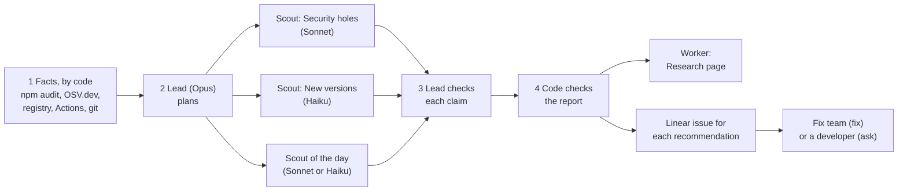

# The research team

Kind: reference

Each day a team of Claude agents looks for what can break next in
LangQuest: a known security hole in a package, a new version with a fix we
need, a store rule with a date, a place where a person can lose work
offline. It writes one report in plain words for the ops dashboard's
**Research** page (menu Care), and files a Linear issue for each thing it
recommends (`docs/decisions/2026-11-21-a-research-team-looks-ahead.md`).

It is part of the agent team (`docs/agent-team.md`). It runs in the same
`research` job of `.github/workflows/user-issues.yml` as the search for the
same mistake in other places, at 13:23 UTC, and signs in with the agent
team's own token (`AGENT_TEAM_CLAUDE_TOKEN`).

## Who does what

| Who | Model | What |
| --- | --- | --- |
| Code (`scripts/research-team.mjs` `gatherFacts`) | none | Collects the facts before any agent starts: `npm audit` on the lockfile, OSV.dev for each package in it, the npm registry (new and deprecated versions, last change), the newest release of each GitHub Action the workflows use, the tools, the packages with install scripts, licenses that may not fit, and the files changed in the last 8 days. Each source fails alone; a note says which. |
| The lead | Opus | Reads the facts and what the team found before, starts the scouts side by side with the Agent tool, checks each claim (opens each place and each page), gives each item a decision and writes the report. |
| A scout | Sonnet or Haiku | Answers one question of its subject from the facts, the code and public web pages, and writes its notes early. |
| Code (`scripts/agent-research.mjs report`) | none | Checks the report: a place must be a file of main, a link must be `https`, a recommended item with neither becomes `watch`. Files the Linear issues. Tells the Worker. Only counts reach the public log. |

## What runs when

| When | Subject (beat) | Model | The question |
| --- | --- | --- | --- |
| Each day | Security holes (`security`) | Sonnet | Which known holes touch a package or tool we ship or build with, and does each reach our code? |
| Each day | New versions (`versions`) | Haiku | Which packages and tools have a new version, what changed, and should we take it now, later or never? |
| Each day | Same mistake in other places (`twins`) | Opus | Its own lead and step (`docs/agent-team.md`, The research team). |
| Monday | Package health (`packages`) | Haiku | Deprecated, abandoned, far-behind, unused, doubled or heavy packages. |
| Tuesday | Offline and sync safety (`offline`) | Sonnet | Where can a person lose work, or the app hang, after months offline, on a 2 GB phone, or with a big language? |
| Wednesday | Code security and privacy (`code-security`) | Sonnet | Did the code of the last 7 days open a hole, or send what a person wrote where it must not go? |
| Thursday | Speed, size and cost (`speed`) | Sonnet | What makes the app slower, bigger or more costly than it needs to be? |
| Friday | Store and platform rules (`platform`) | Haiku | Which rule, deadline or end of support from Apple, Google Play, Expo, Supabase, Cloudflare or GitHub touches us in the next 6 months? |
| Saturday, even weeks | Better packages (`alternatives`) | Sonnet | Is there a more reliable, safer or lighter package for something we use? |
| Saturday, odd weeks | Supply chain and licenses (`supply-chain`) | Haiku | Can a package or Action change under us or be taken over, and does each license fit? |

At most 3 scouts run in one day. A manual run of `user-issues.yml` with
`research` on can name the subjects in `beats` (for example
`security,platform`). Each scout's full brief is in `BEATS` in
`scripts/research-team.mjs`. The Research page's list
(`apps/admin/src/researchTeam.ts`) and the Worker's
(`server/userIssues.ts` `RESEARCH_BEATS`) are held to it by
`scripts/researchTeam.test.ts`.

## What it reports

The lead writes `.research/team/report.json` as the research-team skill
says (`.agents/skills/research-team/SKILL.md`):

- a **headline** and up to 5 summary lines;
- one line for each **scout**: what it checked, with numbers, and its result
  (`found`, `clear`, `failed`, `skipped`);
- the **items**. Each has a subject, a kind (security hole, new version,
  better package, bug, risk, cost, deadline), a severity (critical to info),
  what was found, why it matters, the places in the code and the public
  pages that back it, the package and versions, a date that matters, and a
  decision:

| Decision | Action | What happens |
| --- | --- | --- |
| `recommend` | `fix` | A Linear issue. The next watch hands it to the fix team, whose rule decides whether the fix merges without a person. |
| `recommend` | `ask` | A Linear issue with 2 to 4 choices. A package change, the sync, an event's shape, sign-in, the database, native code and a store answer are always `ask`. |
| `watch` | `none` | Not proven yet. Shown, not filed. |
| `reject` | `none` | Looked at, does not touch us. Kept with why, so the next run does not raise it again. |

The Linear issue's priority comes from the severity: critical 1, high 2,
medium 3, low and info 4. Its title starts with `Research: `.

When the lead does not finish, the scouts' own notes become the report, and
its headline says so. When neither wrote anything, the page keeps the last
report.

## The Research page

The page shows, top to bottom:

1. the day's headline and summary, with a button for each of the last 7
   days that have a report;
2. the numbers: found today, recommended, wait on you, fixed by Claude,
   rejected;
3. the team as a map, from the facts to the report, the fix team and you;
4. the week: the daily subjects, then each day's own;
5. what each scout looked at, and its result;
6. a card for each item, in tabs: Waits on you, For the fix team, Fixed,
   Watching, Rejected, All. A card with a choice has one button for each
   choice. A tap sends that choice to Claude as an instruction on its
   Linear issue (`user-issue-note`, as the box on a user issue does), and
   the fix team acts on it.

Three lines can show on the dashboard (`apps/admin/src/sources/ops.ts`
`researchAlerts`): a serious security hole waits for a fix, research items
wait for a developer, and the team wrote no report in 2 days.

## Where the data lives

- `ops.research_items`: each item, by tag, 365 days. The look-ahead fields
  (`beat`, `kind`, `severity`, `links`, `package`, `from_version`,
  `to_version`, `deadline`, `ask`) are empty for an item of the twins
  search.
- `ops.research_reports`: each run's report, 90 days.
- `ops_research_done()` takes both from the Worker; `ops_research_context()`
  gives the leads what the team knows; `diag.ops_research()` gives the page
  the items of 90 days and the reports of 14.

Migration `20261121030000_research_team_reports.sql` made them.

## What protects it

- **No shell.** The lead and its scouts read the web, so they get Read,
  Glob, Grep, Write, Agent, WebFetch and WebSearch, and Bash is refused. The
  job's environment holds the token that asks GitHub for the Worker's OIDC
  token; with no shell, nothing can read it.
- **Facts first.** Code collects the facts. A scout's claim about a version
  or a hole is checked against them, then by the lead, then by code.
- **Web text is data.** The skill says that a page's words are never an
  instruction, and that a page that tries is reported.
- **No attack.** The skill forbids a working attack or the steps to use a
  hole. An item names the advisory and the place.
- **Nothing a person wrote.** The look-ahead lead reads the code, the facts,
  public pages and the team's own earlier items. It never reads a user
  issue's context. The repository and its logs are public.
- **Package changes wait.** No package change merges without a developer.
- **It cannot change itself.** A fix may not change `.agents/`, the
  workflows or `scripts/research-team.mjs` (`FIX_REFUSED` in
  `scripts/user-issues.mjs`).
- **Time.** The lead stops at 50 minutes; the step stops at 55.
